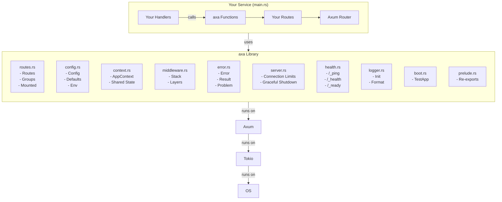
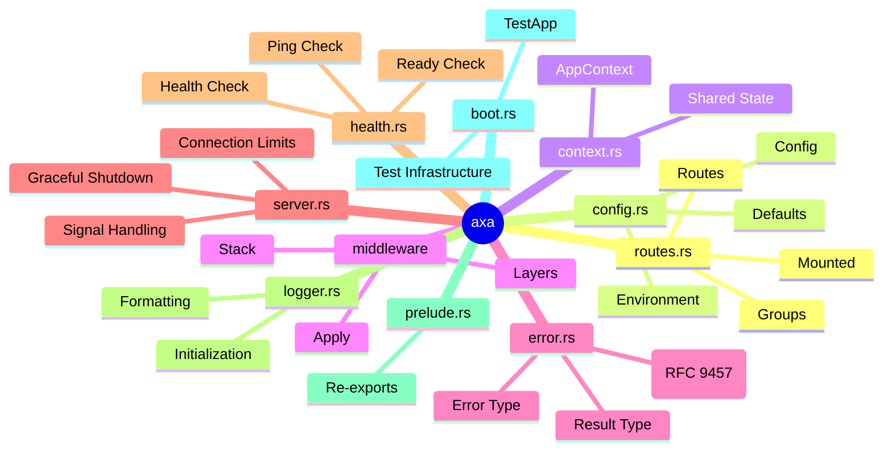
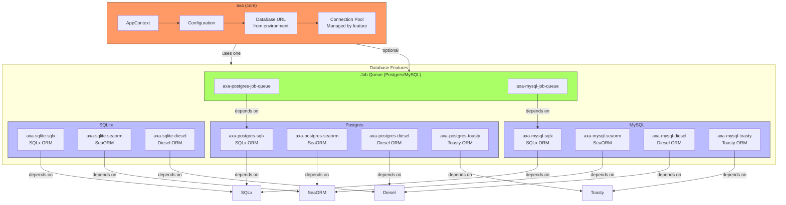

# axa Visual Architecture Diagram

This document provides visual representations of axa's architecture using Mermaid diagrams.
These diagrams complement the textual descriptions in [ARCHITECTURE.md](./ARCHITECTURE.md).

---

## Table of Contents

1. [High-Level Architecture](#high-level-architecture)
2. [Core Crate Structure](#core-crate-structure)
3. [Optional Features Ecosystem](#optional-features-ecosystem)
4. [Request Lifecycle Flow](#request-lifecycle-flow)
5. [Middleware Stack](#middleware-stack)
6. [Database Integration](#database-integration)
7. [Feature Categories](#feature-categories)

---

## High-Level Architecture

This diagram shows how axa fits into the broader Axum ecosystem:



---

## Core Crate Structure

The main `axa` crate consists of these core modules:



---

## Optional Features Ecosystem

axa provides optional features as separate crates, organized by capability:

```mermaid
erDiagram
    axa ||--o{ Database : "23 crates"
    axa ||--o{ JobQueue : "2 crates"
    axa ||--o{ Authentication : "2 crates"
    axa ||--o{ Observability : "3 crates"
    axa ||--o{ API_Docs : "2 crates"
    axa ||--o{ Caching : "2 crates"
    axa ||--o{ Web : "3 crates"
    axa ||--o{ Outbox : "2 crates"
    axa ||--o{ Security : "2 crates"
    axa ||--o{ Versioning : "1 crate"
    axa ||--o{ TestHelpers : "1 crate"
    
    Database ||--|> axa-postgres-sqlx : contains
    Database ||--|> axa-postgres-seaorm : contains
    Database ||--|> axa-postgres-diesel : contains
    Database ||--|> axa-postgres-toasty : contains
    Database ||--|> axa-mysql-sqlx : contains
    Database ||--|> axa-mysql-seaorm : contains
    Database ||--|> axa-mysql-diesel : contains
    Database ||--|> axa-mysql-toasty : contains
    Database ||--|> axa-sqlite-sqlx : contains
    Database ||--|> axa-sqlite-seaorm : contains
    Database ||--|> axa-sqlite-diesel : contains
    
    JobQueue ||--|> axa-queue : contains
    JobQueue ||--|> axa-postgres-job-queue : contains
    JobQueue ||--|> axa-mysql-job-queue : contains
    
    Authentication ||--|> axa-paseto : contains
    Authentication ||--|> axa-keycloak : contains
    
    Observability ||--|> axa-tracing : contains
    Observability ||--|> axa-opentelemetry : contains
    Observability ||--|> axa-prometheus : contains
    
    API_Docs ||--|> axa-openapi : contains
    API_Docs ||--|> axa-swagger-ui : contains
    
    Caching ||--|> axa-redis-cache : contains
    Caching ||--|> axa-memory-cache : contains
    
    Web ||--|> axa-web-session : contains
    Web ||--|> axa-tera : contains
    Web ||--|> axa-cursor-pagination : contains
    
    Outbox ||--|> axa-transactional-outbox : contains
    Outbox ||--|> axa-outbox-encryption : contains
    
    Security ||--|> axa-idempotency-key : contains
    Security ||--|> axa-ratelimit : contains
    
    Versioning ||--|> axa-accepts-version : contains
    
    TestHelpers ||--|> axa-test : contains
```

---

## Request Lifecycle Flow

A complete visualization of the request lifecycle:

```mermaid
flowchart TD
    subgraph Incoming["Incoming Request"]
        A[Client Sends\nHTTP Request] --> B[Connection Accepted]
    end
    
    B --> C[Header Read\nHEADER_READ_TIMEOUT]
    C --> D[Client IP Determined\nTRUSTED_PROXIES]
    D --> E[Request ID Assigned\nx-request-id header or UUID]
    
    subgraph Middleware["Middleware Stack (Outside to Inside)"]
        E --> F1[Custom Layers\n(if added)]
        F1 --> F2[Request ID Layer\nSets x-request-id]
        F2 --> F3[Tracing Layer\nLogs method, route template]
        F3 --> F4[Security Headers\nHSTS, CSP, X-Frame-Options]
        F4 --> F5[CORS Layer\n(if CORS_ALLOWED_ORIGINS set)]
        F5 --> F6[Timeout Layer\nREQUEST_TIMEOUT_SECONDS]
        F6 --> F7[Conditional Request\nETag, 304 Not Modified]
        F7 --> F8[Compression\n(if enabled)]
        F8 --> F9[Body Limit\nBODY_LIMIT_BYTES]
        F9 --> F10[Panic Catch\n500 Internal Server Error]
    end
    
    F10 --> G[Route Matching]
    G --> H[Handler Execution\nYour Code]
    
    subgraph Response["Response Processing"]
        H --> I1[Error Conversion\nTo RFC 9457 Problem]
        I1 --> I2[Conditional Response\n304 if ETag matches]
        I2 --> I3[Security Headers\nAdded if not set]
        I3 --> I4[CORS Headers\nAdded if applicable]
        I4 --> I5[Request ID Added\nTo response header]
        I5 --> I6[Compression\nApplied if enabled]
    end
    
    I6 --> J[Response Sent\nSEND_STALL_TIMEOUT]
    J --> K[Connection\nReturned to pool or closed]
    
    style Incoming fill:#f9f,stroke:#333
    style Middleware fill:#bbf,stroke:#333
    style Response fill:#f96,stroke:#333
```

---

## Middleware Stack Order

The detailed middleware stack with data flow:

```mermaid
flowchart TD
    Request[Incoming\nRequest] -->|1| Custom[Your Custom Layers\nRun INSIDE standard stack\nGet request ID, security headers, CORS\nRefusals have full headers]
    
    Custom -->|2| ReqID[Request ID Layer\nKeeps caller's x-request-id (sanitized)\nMints UUID if none provided\nSets request header to match response]
    
    ReqID -->|3| Tracing[Tracing Layer\nLogs request start\nAdds request ID, method, route template\nNEVER logs path or query (PII)\nLogs response completion]
    
    Tracing -->|4| SecurityH[Security Headers Layer\nx-content-type-options: nosniff\nx-frame-options: DENY\nreferrer-policy: no-referrer\nstrict-transport-security (if HSTS)\ncontent-security-policy (if configured)\nHandler's own headers win over defaults]
    
    SecurityH -->|5| CORSL[CORS Layer\nOnly added if CORS_ALLOWED_ORIGINS is set\nProduction: no CORS unless origins listed\nDevelopment: allows all origins\nRefuses * in production]
    
    CORSL -->|6| TimeoutL[Timeout Layer\nREQUEST_TIMEOUT_SECONDS (default: 60s in prod)\nReturns 408 Request Timeout\nPer-route overrides possible]
    
    TimeoutL -->|7| ConditionalL[Conditional Request Layer\nETag matching\n304 Not Modified responses\nIf-None-Match header handling]
    
    ConditionalL -->|8| CompressL[Compression Layer\nGzip, deflate, brotli\nIf Accept-Encoding allows\nCompresses response body]
    
    CompressL -->|9| BodyLimitL[Body Limit Layer\nBODY_LIMIT_BYTES\nRejects requests exceeding limit\nReturns 413 Payload Too Large]
    
    BodyLimitL -->|10| PanicL[Panic Catch Layer\nTurns panics into 500 Internal Server Error\nLogs full panic information\nPrevents service crash]
    
    PanicL --> Handler[Handler\nYour code executes here]
    
    Handler --> PanicL2[Panic Catch Layer\nCatches panics from handler]
    
    PanicL2 --> BodyLimitL2[Body Limit Layer\nApplied to response]
    BodyLimitL2 --> CompressL2[Compression Layer\nApplied to response]
    CompressL2 --> ConditionalL2[Conditional Request Layer\n304 generation]
    ConditionalL2 --> TimeoutL2[Timeout Layer\nStill applies]
    TimeoutL2 --> CORSL2[CORS Layer\nHeaders added to response]
    CORSL2 --> SecurityH2[Security Headers Layer\nHeaders added if not set]
    SecurityH2 --> Tracing2[Tracing Layer\nLogs response completion]
    Tracing2 --> ReqID2[Request ID Layer\nAdds x-request-id to response]
    ReqID2 --> Custom2[Your Custom Layers\nCan modify response]
    Custom2 --> Client[Response\nSent to Client]
    
    style Request fill:#0af,stroke:#333,color:#fff
    style Client fill:#0af,stroke:#333,color:#fff
    style Handler fill:#fa0,stroke:#333
```

---

## Database Integration

How database features integrate with the core axa crate:



---

## Feature Categories

All axa features organized by category:

```mermaid
flowchart TB
    subgraph Category1["🗄️ Database (12 crates)"]
        PGSQL[Postgres\n4 ORMs]
        MYSQL[MySQL\n4 ORMs]
        SQLITE[SQLite\n4 ORMs]
    end
    
    subgraph Category2["📋 Job Queue (3 crates)"]
        QUEUE[axa-queue\nCore queue]
        PGJQ[axa-postgres-job-queue\nPostgres-backed]
        MYJQ[axa-mysql-job-queue\nMySQL-backed]
    end
    
    subgraph Category3["🔐 Authentication (2 crates)"]
        PASETO[axa-paseto\nPASETO tokens]
        KEYCLOAK[axa-keycloak\nKeycloak integration]
    end
    
    subgraph Category4["🔍 Observability (3 crates)"]
        TRACING[axa-tracing\nTracing support]
        OTEL[axa-opentelemetry\nOpenTelemetry]
        PROM[axa-prometheus\nPrometheus metrics]
    end
    
    subgraph Category5["📖 API Documentation (2 crates)"]
        OPENAPI[axa-openapi\nOpenAPI spec]
        SWAGGER[axa-swagger-ui\nSwagger UI]
    end
    
    subgraph Category6["💾 Caching (2 crates)"]
        REDIS[axa-redis-cache\nRedis cache]
        MEMORY[axa-memory-cache\nIn-memory cache]
    end
    
    subgraph Category7["🌐 Web (3 crates)"]
        SESSION[axa-web-session\nSession management]
        TERA[axa-tera\nTemplate rendering]
        CURSOR[axa-cursor-pagination\nCursor pagination]
    end
    
    subgraph Category8["📦 Outbox Pattern (2 crates)"]
        OUTBOX[axa-transactional-outbox\nOutbox pattern]
        ENCRYPT[axa-outbox-encryption\nEncryption for outbox]
    end
    
    subgraph Category9["🔒 Security (2 crates)"]
        IDEMP[axa-idempotency-key\nIdempotency keys]
        RATELIMIT[axa-ratelimit\nRate limiting]
    end
    
    subgraph Category10["📊 Versioning (1 crate)"]
        ACCEPTS[axa-accepts-version\nAccepts-Version header]
    end
    
    subgraph Category11["🧪 Testing (1 crate)"]
        TEST[axa-test\nTest helpers]
    end
    
    axa[("axa core")] --> Category1
    axa --> Category2
    axa --> Category3
    axa --> Category4
    axa --> Category5
    axa --> Category6
    axa --> Category7
    axa --> Category8
    axa --> Category9
    axa --> Category10
    axa --> Category11
    
    style axa fill:#fff,stroke:#333,stroke-width:3px
```



---

## How to Use These Diagrams

1. **In GitHub**: Mermaid diagrams render automatically in Markdown files
2. **In VS Code**: Install the [Mermaid extension](https://marketplace.visualstudio.com/items?itemName=bierner.markdown-mermaid) for live preview
3. **In documentation**: These diagrams will render when viewing on GitHub or in any Mermaid-compatible viewer
4. **For editing**: Use the [Mermaid Live Editor](https://mermaid.live) to modify and test diagrams

---

## Diagram Legend

| Color | Meaning |
|-------|---------|
|  Light Pink | Your Service / Input/Output |
|  Light Blue | axa Core Components |
|  Orange | Feature Crates |
|  Teal | Data Flow |
|  Gold | User Code / Handlers |
|  Light Green | Integration Points |

---

## See Also

- [ARCHITECTURE.md](./ARCHITECTURE.md) - Detailed architectural principles and design
- [FEATURES.md](./FEATURES.md) - Complete list of all available features
- [QUICKSTART.md](./QUICKSTART.md) - Quick start guide for using axa
- [EXAMPLES.md](./EXAMPLES.md) - Usage examples and recipes
